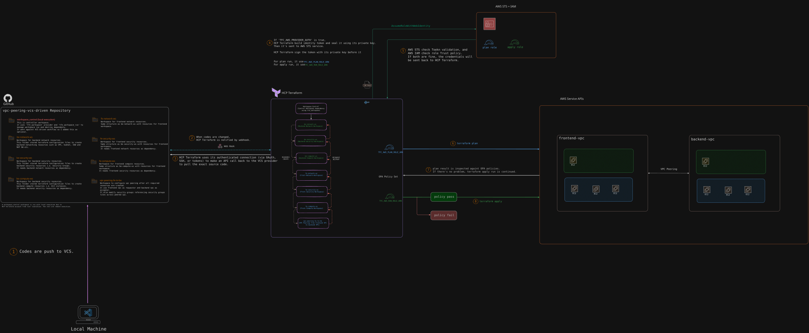
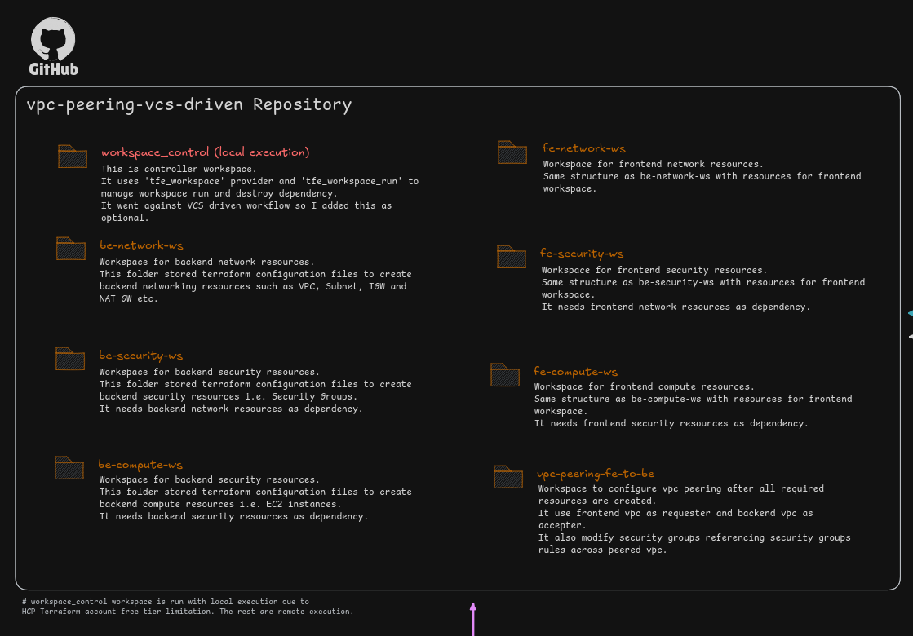

# Building Inter-Region VPC Peering with OIDC Credentials

This repository provides Terraform configurations to establish cross-region VPC Peering between two AWS regions, provisioning network (VPC, subnets, IGW, etc.), security (Security Groups), and compute (public and private EC2 instances) resources for both frontend and backend environments:

- **Frontend (FE) VPC:** `ap-northeast-1` (Tokyo)
- **Backend (BE) VPC:** `ap-southeast-1` (Singapore)

## Goal

The main goal of this project is hands-on practice with:

- Splitting workspaces by resource category
- Configuring AWS Dynamic OIDC credentials
- Enforcing Open Policy Agent (OPA) policies

## Architecture Diagram




- [View interactive diagram on Excalidraw](https://excalidraw.com/#json=a89AwSruplf1zEcKZRGK4,udsL9R3XqNMRhhiYIvdZcg)

## Repo Structure



The infrastructure is split into six core workspaces—covering network, security, and compute for both frontend and backend—based on how frequently each layer changes. A dedicated VPC Peering workspace with its own state file runs afterward, once all prerequisite resources are created.

### 1. `fe-network-ws` and `be-network-ws`

Core network infrastructure:

- Virtual Private Cloud (VPC)
- Public and Private Subnets
- Internet Gateways (IGW) & NAT Gateways
- Route Tables and Routing Entries

### 2. `fe-security-ws` and `be-security-ws`

Network access control configurations:

- Security Groups
- Ingress and Egress Rules (including cross-region rules)

### 3. `fe-compute-ws` and `be-compute-ws`

Compute instances and access keys:

- Public and Private EC2 Instances
- EC2 Key Pairs

### 4. `vpc-peering-fe-to-be`

Establishes the VPC peering connection and configures the corresponding routes and security group rules afterward:

- VPC Peering Connections
- Peered Connection Routing Entries
- Peered Connection Ingress and Egress Rules

> All workspaces above use a **VCS-driven workflow with Remote Execution**.

### 5. `workspace_control`

Orchestrates initial resource creation and clean-up using `tfe_workspace` and `tfe_workspace_run` to apply and destroy workspaces in order. It runs with **local execution**.

## How to Deploy / Clean Up

### Prerequisites

- Create the required workspaces beforehand in HCP Terraform so `workspace_control` can look them up:
  `["be-network-ws", "be-security-ws", "be-compute-ws", "fe-network-ws", "fe-security-ws", "fe-compute-ws", "vpc-peering-fe-to-be"]`
- Configure each workspace with a **VCS-driven workflow** connected to this repository so `tfe_workspace_run` executes against the `.tf` files in VCS.
- Configure the **AWS IAM Identity Provider (OIDC)** for HCP Terraform.
- Configure **AWS IAM Roles** for `plan` and `apply` runs.
- Configure [**OPA Policies and Policy Sets**](docs/OIDC%20(OpenID%20Connect)_guide.md).


### Deploy

Navigate to the `workspace_control` directory and run Terraform:

```bash
cd workspace_control
terraform init
terraform plan
terraform apply
```

### Clean Up

Destroy all managed resources from the `workspace_control` directory:

```bash
terraform destroy
```