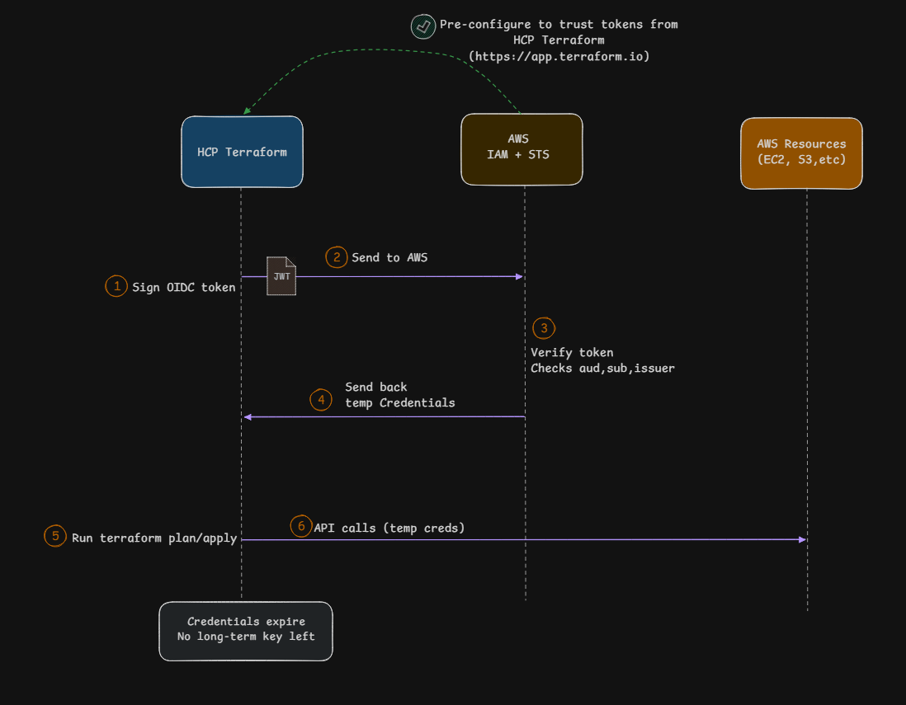

# OIDC (OpenID Connect)

An open standard that allows one system to prove its identity to another using a signed token (JWT). 
*Used by: Google Login, GitHub Actions, and HCP Terraform.*

Instead of using long-term, high-risk credentials (like AWS access keys and secret keys), OIDC enables secure, short-term authentication.

---

### **IAM: The Rule Book**
IAM defines identities (users, roles) and permissions (policies).
* **IAM Role:** An identity with no passwords or permanent keys. Nobody "is" a role permanently; they temporarily assume it.
* **Trust Policy:** Dictates *who* is allowed to assume the role.
* **Permission Policy:** Dictates *what* the role is allowed to do once assumed.

### **STS: The Ticket Counter**
AWS Service that issues **temporary credentials**. 
When a workload wants to assume an IAM role, it asks STS. STS checks the role's trust policy, and if valid, issues temporary access keys, secret keys, and a session token (typically expiring in 1 hour).

### Verification Flow

#### Step 1 & 2: Token Issuance
HCP Terraform issues the OIDC token, which is sent to AWS for verification.

#### Step 3: Signature & Discovery
* AWS is configured with the provider URL: `https://app.terraform.io`.
* To verify the signature, AWS fetches HCP Terraform’s public key from its discovery endpoint (`app.terraform.io/.well-known/openid-configuration`).
* A matching signature proves the request genuinely originated from HCP Terraform.

#### Verifying `sub` (Subject)
* **What it is:** Identifies the specific source within HCP Terraform (e.g., organization, project, workspace, and run phase). Without it, AWS would accept tokens from *any* HCP Terraform user worldwide.
* **Format:** `organization:<ORG_NAME>:project:<PROJECT_NAME>:workspace:<WORKSPACE_NAME>:run_phase<plan|apply>`
* **Usage:** Added as a `Condition` in the IAM Role trust policy to restrict access.

#### Verifying `aud` (Audience)
* **What it is:** Specifies who the token is intended for, preventing token reuse across different systems (e.g., a Vault token being used against AWS STS).
* **Default Value:** HCP Terraform defaults AWS audience to `aws.workload.identity` (customizable via `TFC_AWS_WORKLOAD_IDENTITY_AUDIENCE`).

---

### Setting Up OIDC in Terraform

1. **Configure AWS IAM Identity Provider:**
   * Provider URL: `https://app.terraform.io`
   * Audience: `aws.workload.identity`

2. **Configure HCP Terraform Environment Variables:**
   * `TFC_AWS_PROVIDER_AUTH` = `true`
   * Role assignment (choose one or both):
     * `TFC_AWS_RUN_ROLE_ARN` (Default for both plan and apply)
     * `TFC_AWS_PLAN_ROLE_ARN` / `TFC_AWS_APPLY_ROLE_ARN` (Specific to plan or apply)
   * *Note: For other clouds, use `TFC_AZURE_*`, `TFC_VAULT_*`, etc.*

3. **Set AWS IAM Trust Policy:**
   * Restrict access conditions using `sub` and `aud`.

---

### OAuth 2.0, SAML 2.0, & OIDC

#### OAuth 2.0
Allows a third-party app to access a service on your behalf without exposing your password (e.g., granting a calendar app access to Google Calendar). 
* *Limitation:* It does not verify the identity of the person holding the token, which is why OIDC was created.

#### OIDC (OpenID Connect)
Built on top of OAuth 2.0, OIDC adds an **ID Token** (JWT) containing identity details like `sub` (subject), `iss` (issuer), and `aud` (audience). 
* Optimized for mobile apps, APIs, and machine-to-machine auth (e.g., "Sign in with Google").

#### SAML 2.0
An enterprise-focused SSO standard using signed XML assertions passed via browser redirects (used by Okta, Entra ID, corporate portals). 
* *Limitation:* Designed for browser flows, making it unsuited for CI/CD pipelines, machines, or Terraform.
